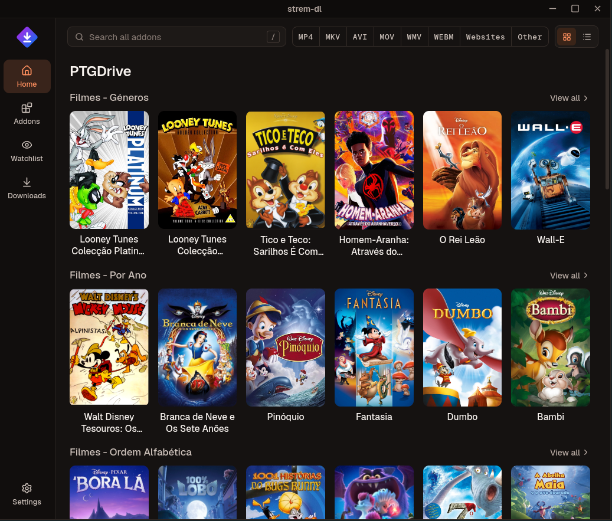
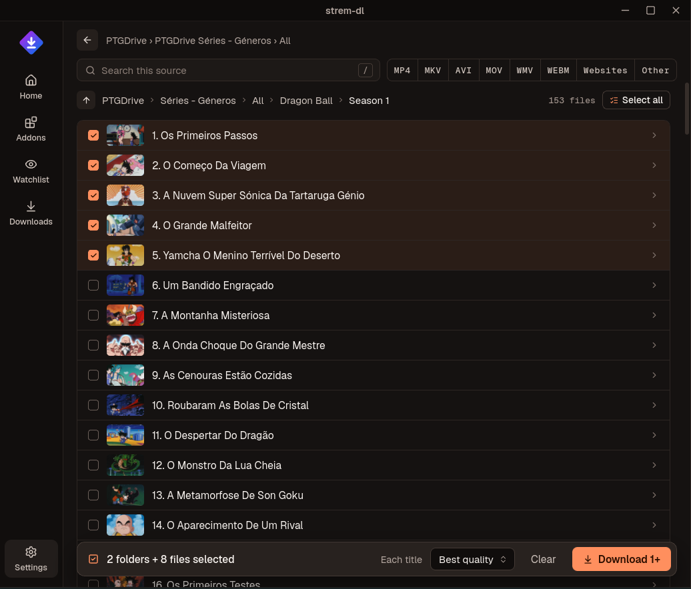
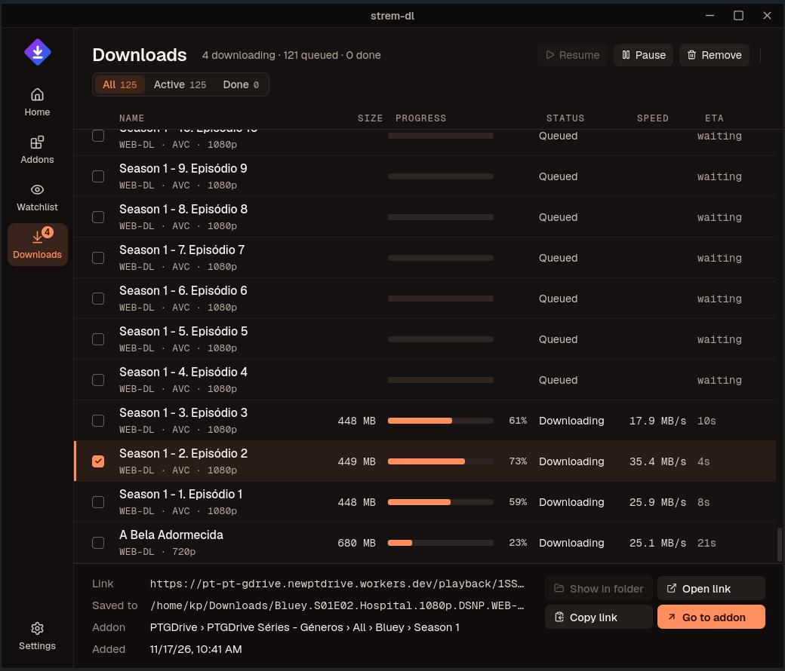

# strem-dl

Browse any [Stremio addon](https://github.com/Stremio/stremio-addon-sdk) as a directory tree. Unlike in the Stremio app, with strem-dl you can:

* Select from multiple sources at once

* Bulk download entire folders (i.e. a full season)

* Download from third-party hosted platforms automatically - in cases where multiple sources are available, you can configure where to pick from

Only download what you have the right to. Images below are mock examples, not real content.





## App vs. web client

Strem-dl comes in two flavours: the standalone app (Windows, Linux, MacOS) and the web client which requires no installation at all.

| | Web | Desktop |
|---|---|---|
| Search, addons, watchlist | Yes | Yes |
| Addons without CORS headers | Fail | Work |
| Double-clicking a link | Opens it in a new tab | Downloads it |
| Downloads, queue, resume | No | Yes |
| Ticking folders and links | Copies their links | Queues them |
| Video from streams and embed pages | No, and a notice says so | Yes |
| Setup | None | yt-dlp and ffmpeg, on first launch |
| Saved in | Local storage | SQLite (`strem-dl.db`) |

A web page can't see what other pages load, run programs or save to disk, so app-driven video downloads need the desktop app.

## Installing

Head over to the [releases page](https://github.com/sergiocastrovale/strem-dl/releases) and download. 

### MacOS

1. Download the `.dmg` for your chip from the [releases](../../releases): `aarch64` for Apple Silicon (M1 and later), `x64` for Intel.
2. Open it and drag **strem-dl** into **Applications**.
3. The app isn't notarized, so macOS blocks the first launch. Remove the quarantine flag once:

   ```bash
   xattr -cr /Applications/strem-dl.app
   ```

   Or right-click the app, choose **Open**, then **Open** again. On recent macOS, use **System Settings > Privacy & Security > Open Anyway**.

## First launch (desktop)

The setup will guide you through the libraries you need for the downloader to work:

- **yt-dlp** saves video streams.
- **ffmpeg** joins video and audio into one file.

These will be installed in:

| | App data, including `bin/` for the programs | Database and settings |
|---|---|---|
| Linux | `~/.local/share/com.stremdl.app/` | `~/.config/com.stremdl.app/` |
| Windows | `%APPDATA%\com.stremdl.app\` | Same |
| macOS | `~/Library/Application Support/com.stremdl.app/` | Same |

You can opt to install later via Settings page.

## Usage

On the Addons page, paste an addon URL and press Enter, for example `https://v3-channels.strem.io`. A missing `/manifest.json` or scheme is assumed. Every URL you enter is added to the addons list, and Home loads all your addons at once. Search on Home looks through all of them together.

Downloads depend on the type of link:

| Link | What happens |
|---|---|
| File | Downloads directly |
| HLS or DASH | Saved with yt-dlp and ffmpeg |
| Page | yt-dlp tries first, then a hidden window starts the player and notes what it loads |
| Magnet | Opens in your torrent app |

If a hidden window finds nothing in about 20 seconds, the page appears so you can press play. Close it if the link was just a website. If a video link expires mid-download, the app finds it again once and continues.

Those windows run other people's code, ads included. They use a separate temporary profile, block pop-ups and downloads, and can only report a video address.

On the Downloads page, double-click an unfinished download to pause or start it, or a finished one to open its folder.

### Bulk and sources (desktop)

Tick folders or links and press **Download**. Addons often list a title on several hosts, so **Each title** chooses what to queue:

- **First copy**: the one listed first.
- **Best quality**: the highest resolution, then the biggest file.
- **Smallest file**: the smallest. Copies that don't state a size are the last resort.
- **All copies**: all of them.

A link you tick by itself is always queued. **Download** shows how many files that makes, with a **+** when part of the selection isn't loaded yet.

If a source saves no video, the app tries the title's other sources by itself, and **Sources tried** in the row's details says why each failed. A source that stopped partway stays **Failed** so **Resume** can continue it. Pages in bulk never open a window: if nothing else works, the row fails, and **Resume** retries with the page showing.

## Supported sites

Direct files are downloaded as they are, and everything else goes to yt-dlp, which covers [about 1800 sites](https://github.com/yt-dlp/yt-dlp/blob/master/supportedsites.md). If yt-dlp has no extractor for a page, the app loads it and looks for the video it requests. This list comes from what yt-dlp supports. It hasn't been tested site by site.

**Likely to work**

- **General video:** YouTube, Vimeo, Dailymotion, Twitch (VODs and clips), Facebook, Instagram, TikTok, X/Twitter, Reddit, Bilibili, Rumble, Odysee, Streamable, Archive.org.
- **Broadcasters (free content, may be region-locked):** BBC iPlayer, ITVX, Channel 4, ARD, ZDF, Arte, RTVE, RAI, France.tv, NRK, SVT, CBC, ABC (AU), PBS, Tubi, Pluto TV.
- **Embed hosts used by addons (varies, breaks often):** Streamtape, Doodstream, Mixdrop, Voe, Filemoon, Vidmoly, Streamwish, Vidoza, Upstream, Uqload, Mp4upload, Sibnet, OK.ru, VK.
- **Direct links**, including debrid-backed addons such as Torrentio.

## Limitations

- DRM-protected video and live streams can't be saved.
- Hosts that need a login or cookies fail.
- Hosts can change their players at any time, which may break finding the video.
- Fedora needs H.264 for GStreamer from RPM Fusion.
- Catalogs that need the addon's own search stay locked.

## Local builds and development

### Web

```bash
pnpm install
pnpm dev    # http://localhost:1420
pnpm build  # static site in dist/
```

### Desktop

```bash
pnpm install
pnpm tauri dev    # run from source
pnpm tauri:wsl    # same, hiding WSL's harmless "Dropped Escape call" GPU message
pnpm tauri build  # packages in src-tauri/target/release/bundle/
```

Build on the OS you're targeting.

| Platform | Tools | Packages |
|---|---|---|
| Linux | See below | `.AppImage`, `.deb`, `.rpm` |
| Windows | See below. Use a Windows drive, not WSL | `-setup.exe`, `.msi` |
| macOS | `xcode-select --install`, then `brew install node pnpm rust` | `.dmg`, `.app` |

#### MacOS

macOS needs the Xcode command line tools and [Homebrew](https://brew.sh):

```bash
pnpm install
pnpm tauri build    # builds for this Mac's chip
```

Output is in `src-tauri/target/release/bundle/`: `dmg/strem-dl_<version>_<arch>.dmg` and `macos/strem-dl.app`. `aarch64` is Apple Silicon, `x64` is Intel. The build is ad-hoc signed only, not notarized. To build both chips, add the other target with `rustup target add x86_64-apple-darwin` (or `aarch64-apple-darwin`) and run `pnpm tauri build --target <that target>`. Or run **Build macOS** under Actions, which builds both.

```bash
xcode-select --install
brew install node pnpm rustup
rustup default stable
pnpm build:local
```
macOS blocks the app until its quarantine flag is removed, with `xattr -cr /Applications/strem-dl.app`.

### Debian or Ubuntu

```bash
sudo apt install libwebkit2gtk-4.1-dev build-essential curl wget file libxdo-dev libssl-dev libayatana-appindicator3-dev librsvg2-dev gstreamer1.0-libav gstreamer1.0-plugins-good gstreamer1.0-plugins-bad
pnpm build:local
```

### Windows, (in PowerShell)

```powershell
winget install OpenJS.NodeJS.LTS pnpm.pnpm Rustlang.Rustup
winget install Microsoft.VisualStudio.2022.BuildTools --override "--wait --passive --add Microsoft.VisualStudio.Workload.VCTools --includeRecommended"
rustup default stable
pnpm build:local
```

The packages aren't signed, so Windows SmartScreen warns about them.

